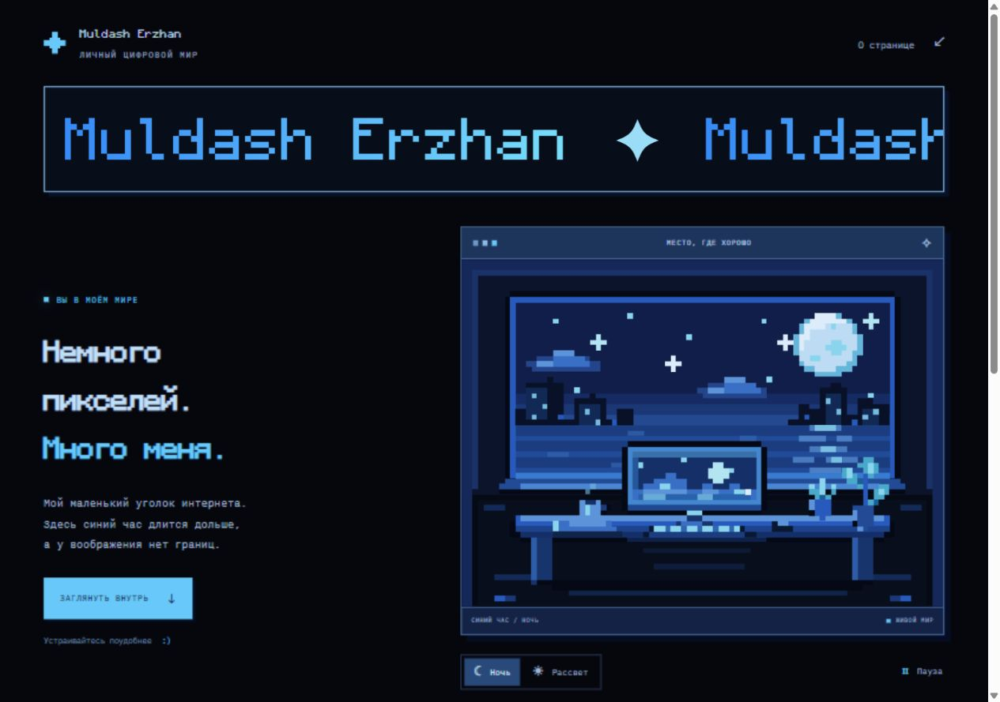

# Pixel World

A personal pixel-art website for **Muldash Erzhan**, with a near-black background, azure accents, and Minecraft-inspired Monocraft lettering.

## Features

- A seamless name marquee moving from left to right.
- An original animated pixel room with drifting clouds, stars, and a glowing computer screen.
- Night and Dawn lighting, plus a pause control for the room and marquee.
- Reduced-motion preferences respected by default, with a manual option to start animation.
- Responsive layout, keyboard-friendly controls, and a copy-link button with a manual fallback.
- Lighting and motion preferences remembered when browser storage is available.

## Quick start

Open **index.html** in a browser. No installation or build step is needed; fonts, scripts, styles, and artwork are included locally.

## Files

- `index.html` — the page and its inline room illustration.
- `style.css` — layout, colors, fonts, and marquee animation.
- `app.js` — lighting, motion, saved preferences, and link copying.
- `scene.svg` — a standalone copy of the room artwork. To change the artwork shown on the page, update the inline SVG in `index.html` as well.
- `assets/` — local fonts, their licenses, favicon, and preview image.

## Font licenses

Monocraft is distributed under the [SIL Open Font License 1.1](assets/font-license.txt). IBM Plex Mono is distributed under the [SIL Open Font License 1.1](assets/mono-license.txt).

A repository-wide license has not been selected.
